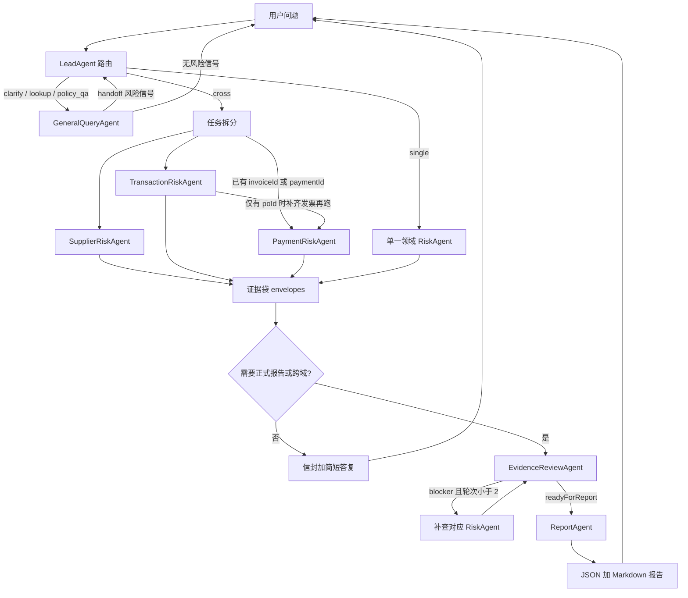
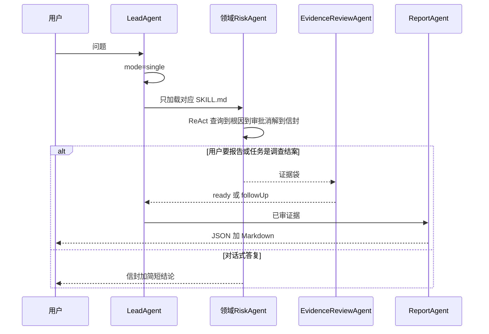
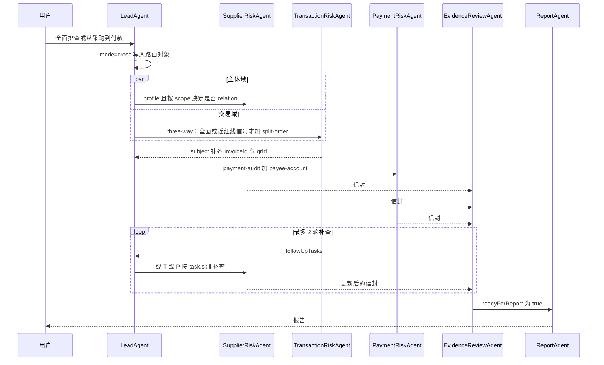
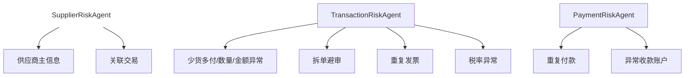

# Finprobe

面向启衡精密制造有限公司采购到付款（P2P）全链路的 Multi-Agent 风控调查系统。

当前仓库交付 **Mock ERP HTTP API + MCP Tools + Agent Skills**。Codex（以及后续 `src/backend` 编排器）按本文件扮演 LeadAgent 并调度领域 Agent。`src/backend` 与 `src/frontend` 仍是空目录；实现时必须遵循本协议，不要另起流程。

本文件是 Agent 的执行合同。`项目规划.md` 是产品叙事；**冲突时以本文件为准**。风险阈值、输出字段和示例以各 `skills/*/SKILL.md` 为准，不要把规划稿里的过时字段抄进代码或结论。

## Read What The Task Needs

不要在每次编辑前通读仓库。按任务取文档：

| 任务 | 读这些 |
| --- | --- |
| 改路由 / 多 Agent 协作 / 编排器 | 本文件 Architecture |
| 改某一风险的调查步骤或阈值 | 只读对应 `skills/<name>/SKILL.md` 及其 `references/` |
| 改 MCP 工具契约、摘要、artifact | `mcp-server/tools.py`、`mcp_erp_readme.md` |
| 改 ERP 过滤 / 分页 / 字段 | `mock-erp/store.py`、`mock-erp/server.py` |
| 对已标注风险样本 | `mock-erp/data/风险Case清单.md` |
| 改制度问答 | `skills/internal-policy-qa-skill/` 与 `mock-erp/data/docs/` |

不要一上来读完全部 10 份 `SKILL.md`。不要把 `mock-erp/data/*.json` 当调查数据源直接打开；调查必须走 MCP。

## Repository Layout

```
Finprobe/
  AGENTS.md                 本文件：架构、路由、协作、约束
  项目规划.md               产品叙事（过时字段以本文件和 Skills 为准）
  mcp.json                  Codex/Cursor MCP 配置
  mcp_erp_readme.md         ERP vs MCP 分层说明
  requirements.txt          httpx；mcp 可选
  mock-erp/                 模拟 ERP（REST，不是 MCP）
    server.py store.py config.py
    data/                   主数据、三单、付款、审批 JSON + docs 制度
  mcp-server/               MCP 适配器：HTTP 调 ERP，禁止读 JSON 文件
  skills/                   10 个业务 Skill
  src/backend               编排器（待实现）
  src/frontend              对话 UI（待实现）
  tests/                    评测与回归（待实现）
  scripts/                  启动脚本
  .tmp/finprobe-artifacts/  MCP 大结果落盘，勿提交
```

## Architecture

### 分层

调查运行时只有这一条数据路径：

```
用户 → LeadAgent（路由，不查风险）
     → 领域 Agent（ReAct）
       → Skill（查什么、如何分级、如何消解）
         → MCP Tool（mcp-server）
           → HTTP + X-Api-Key → mock-erp → mock-erp/data
```

禁止倒转：

- Agent / Skill 不得 `curl` ERP，不得直接读 `mock-erp/data/*.json`
- MCP 不得直接读 JSON 文件；以后换真实 ERP 只改 `ERP_BASE_URL`
- Skill 不是数据接口；MCP 不是调查剧本；制度问答不是风控结论

当前由 Codex 充当运行时 LeadAgent：先完成本文件路由，再 **只加载选中的** `SKILL.md`。后续 `src/backend` 必须实现同一协议：每个领域 Agent 是 subagent，只带自己的 Skill 与 MCP。LeadAgent 主线程只做路由、证据袋合并与对用户答复。

### 系统结构



### 七个 Agent

规划稿写「单一任务分给 3 个专长之一」不完整。完整角色是 7 个：

| Agent | 职责 | 不做什么 |
| --- | --- | --- |
| LeadAgent | 抽实体、定 scope/mode、选 Agent 和 Skill、合并证据袋、决定是否审核/出报告 | 不下风险等级；不做三单或付款分析；最多 1 次定位查询 |
| SupplierRiskAgent | ① 主信息 ② 关联关系 | 不判三单、拆单、付款 |
| TransactionRiskAgent | ③ 少货多付 ④ 拆单 ⑤ 重复发票 ⑥ 税率 | 不判重复付款、收款账户 |
| PaymentRiskAgent | ⑦ 重复付款 ⑧ 异常收款账户 | 不重做三单数量匹配 |
| GeneralQueryAgent | 制度问答、查单、澄清；发现信号后 handoff | 禁止输出最终风险等级 |
| EvidenceReviewAgent | 规则层加语义层审证据袋，产出 followUpTasks | 不查 ERP，不编造审批，不改原始 facts |
| ReportAgent | 已审证据写成 JSON 加 Markdown | 不查 ERP，不发明新风险类型 |

### 先定 scope，再派 Agent

规划稿默认跨域就跑齐三个 RiskAgent、十个 Skill，这会浪费调用并污染结论。先定调查范围：

| scope | 何时 | 默认 Skill |
| --- | --- | --- |
| `policy` | 问制度、限额、差旅、审批门槛，不判断某张单据 | `internal-policy-qa-skill` |
| `lookup` | 「这张 PO/发票是什么」、模糊检索 | `general-query-skill` |
| `document` | 对象是一张 PO/GR/INV/PAY | 三单匹配 + 该发票的付款两项；对该供应商做主信息。拆单/关联仅当用户要「全面」或已出现信号 |
| `supplier` | 「全面排查 VEN-xxxx」 | 该供应商全部 6 个调查 Skill |
| `population` | 「有没有关联供应商 / 重复建档」 | `supplier-relation-audit-skill`（全量 vendor-query） |

信号升级：lookup/document 过程中若 summary 出现同一发票多笔 PAID、数量差超容差、收款户名为个人、5 日内多笔近红线 PO、共享电话/税号，LeadAgent 必须升 scope 并改派，而不是让 GeneralQueryAgent 写完结论。

### 路由 mode

| mode | 条件 | 后续 |
| --- | --- | --- |
| `clarify` | 非制度问题且缺少可绑定实体 | 只问 **一个** 澄清问题 |
| `policy_qa` | 纯制度 | GeneralQueryAgent + `internal-policy-qa-skill`；不出报告 |
| `lookup` | 查单/探查 | GeneralQueryAgent；不出风险等级；有信号则 handoff 回 LeadAgent |
| `single` | 只命中一个领域 | 一个 RiskAgent ReAct |
| `cross` | 两个及以上领域，或用户明确「从采购到付款 / 全面排查」 | 多 Agent 协作 |

LeadAgent 必须先写出路由对象（可写入证据袋）：

```json
{
  "mode": "cross",
  "scope": "document",
  "subject": {"poId": "PO-01332", "supplierId": null, "invoiceId": null, "paymentId": null},
  "agents": ["TransactionRiskAgent", "PaymentRiskAgent", "SupplierRiskAgent"],
  "skills": ["p2p-three-way-match-skill", "payment-audit-skill", "payee-account-security-skill", "supplier-profile-audit-skill"],
  "reason": "用户点名 PO 并要求给出能否付款的结论",
  "clarifyQuestion": null
}
```

绑定实体：用户只给名称时，LeadAgent **可以**打 1 次 `vendor-query` 或 `po-query(keyword=)` 把名称收成 ID，然后立刻停止查询并进入分发。禁止把定位查询扩成调查。

### 意图到 Skill

| 用户意图 | Agent | Skill | 必查 MCP |
| --- | --- | --- | --- |
| 档案/准入/税号或账户缺失、频繁改档 | SupplierRiskAgent | supplier-profile-audit-skill | vendor-query, approval-query |
| 关联、重复建档、同电话/税号/账号 | SupplierRiskAgent | supplier-relation-audit-skill | vendor-query, po-query, financial-analysis, approval-query |
| 三单、超开、短收、重复发票、税率 | TransactionRiskAgent | p2p-three-way-match-skill | po-query, gr-query, invoice-query；税率再加 vendor-query；消解加 approval-query |
| 拆单、化整为零、大额红线 | TransactionRiskAgent | split-order-audit-skill | po-query(clusterWindowDays=5), approval-query |
| 重复付款、一票多付 | PaymentRiskAgent | payment-audit-skill | payment-query, invoice-query |
| 收款账户、打到个人 | PaymentRiskAgent | payee-account-security-skill | payment-query, vendor-query；不一致必须 approval-query |
| 差旅/报销/内控条款 | 共享 | internal-policy-qa-skill | policy-query |
| 杂项查单、模棱两可 | GeneralQueryAgent | general-query-skill | 最少查询 |
| 跨域或出正式报告前 | EvidenceReviewAgent | evidence-validation-skill | 无（只审信封） |
| 出 JSON 加 MD 报告 | ReportAgent | risk-report-generator-skill | 无 |

`internal-policy-qa-skill` 是 **共享技能**，不是三个领域各复制一份。领域 Agent 查阈值可以引用它；用户要判断某张单据是否违规时必须切到调查 Skill。

一共 **10 个独立 Skill 目录**。名称用连字符：`evidence-validation-skill`，不要写成 `evidence_validation_skill`。

### 协作时序

**单一领域**



**跨域：默认并行，付款有条件串行**

规划稿写「Payment 一律放在三单之后」过严。正确规则：

- `SupplierRiskAgent` 与 `TransactionRiskAgent` **并行**
- `PaymentRiskAgent`：若用户已给 `invoiceId` 或 `paymentId`，与 Transaction **并行**；若只有 `poId` / 供应商、尚无发票号，则等 Transaction 回传 `invoiceId` 后再跑
- 不要在付款-only 问题上先跑三单



**杂项 / 制度**

GeneralQueryAgent 先分类 `policy_qa` / `document_lookup` / `clarify` / `handoff`。`handoff` 必须回到 LeadAgent 重新路由，禁止自己写 `高风险/中风险/低风险` 作为最终结论。

**证据闭环**

调查 → 审核 → 补查 → 结论。

- `cross` 必须进 EvidenceReview
- 只要派 ReportAgent，必须先 EvidenceReview
- `policy_qa` / `lookup` / `clarify` 不进审核、不出报告
- EvidenceReview **禁止**调用 query 工具补数，只输出 `followUpTasks`
- 补查轮次上限 **2**（最多 3 次审核）。仍有 blocker 时：`readyForReport=false`，ReportAgent 只能出草稿并列出缺口，或 LeadAgent 直接说明证据不足
- 领域 Agent 不得因为「没看见审批」就写无审批：`approvalStatus` 必须来自已执行的 `approval-query`（允许 `totalCount=0` → `NOT_FOUND`）
- 领域 Agent 步数耗尽时必须输出「证据不足」信封，不得让单域失败否掉已完成信封；跨域继续 Payment 与 EvidenceReview
- 供应商全量三单禁止按 PO 循环 `gr-query`：`po-query` / `invoice-query` / `gr-query(supplierId)` 各至多一次列表，大结果走 artifact + `financial-analysis`

### LeadAgent 执行步骤

1. 从用户文本抽出 `supplierId` / `poId` / `grId` / `invoiceId` / `paymentId` / 供应商名称。
2. 定 `scope` 与 `mode`。缺实体且非制度 → `clarify`，停止。
3. 需要绑定时最多 1 次定位查询。
4. 按范围选 Agent 和 Skill，**只读这些 SKILL.md**。
5. 分发：single 直接 ReAct；cross 按并行/有条件串行。
6. 收集统一调查信封，放进证据袋。发现 `handoff` 则加派，不丢弃已有信封。
7. 若要正式报告或 `mode=cross`：跑 `evidence-validation-skill`；可先跑 `python skills/evidence-validation-skill/scripts/validate_evidence.py` 做规则层，语义层必须再审。
8. `readyForReport=true` 才调用 ReportAgent；否则补查或向用户说明缺口。
9. 对用户只由 LeadAgent 汇总。领域 Agent 的 JSON 是内部产物。

领域 Agent ReAct 最小闭环：定位单据 → 调必查工具 → 用 summary/artifact，禁止要全量原文 → 写 facts/metrics → 查审批消解 → 给 `riskLevel` 与 `rootCause`（机制，不是「对不上」）。

### MCP 与大结果

列表工具契约：

- 小结果（默认 ≤8 条，供应商 ≤50）内联 `data`
- 大结果只给 `summary` + `sample`（默认 5 条）+ `artifact`
- 聚合用 `financial-analysis(artifactIds=[...])`，再看几条用 `artifact-get`
- 禁止要求工具「把全部发票原文返回」

九个 MCP 工具：`vendor-query` `po-query` `gr-query` `invoice-query` `payment-query` `approval-query` `policy-query` `financial-analysis` `artifact-get`。

`financial-analysis`：沙箱 Python；必须赋值 `result=...`；允许 `try/except` 与 `isinstance`；禁止 `import`、`type()` 与下划线属性；可用已注入的 `defaultdict`、`Counter`、`to_number`、`math`、`datetime`。发票 `total` / `tax` / `amountExclTax` 是 **字符串**，PO `totalWithTax` 是数字，比较前必须 `to_number`。PO 行字段是 `itemCode`，发票行是 `item_code`。

`po-query(..., clusterWindowDays=5)` 才会带 `splitClusters`。`gr-query` 可用 `poId` 核对单张，或 `supplierId` 一次拉该供应商入库（经 PO 关联）；禁止按 PO 循环。`financial-analysis` 允许 `try/except`、`isinstance`；禁止 `import`/`type()`/`getattr`，必须 `result=...`，金额先 `to_number`。制度全文在 artifact，回答时引用条款原文。

### Mock ERP 事实

路径是 `mock-erp/data/`。以 MCP 返回为准，不以规划示例为准。

| 对象 | 实际规模 | 关键字段 |
| --- | --- | --- |
| 供应商 | 27 | `id, code, name, shortName, taxNo, category, paymentTermsDays, contactName, contactPhone, bankAccount, active`。当前 dump **没有** `creditCode` |
| PO | 894 | `poId, supplier.supplierId, items[].itemCode, taxRate, totalWithTax, status`。当前全部 `APPROVED` |
| GR | 893 | `grId, poId, warehouse_location, receivedBy, lines[].receivedQuantity` |
| 发票 | 894 | `invoiceId, purchaseOrderId, invoiceCode, invoiceNo, items[].item_code, taxRate, total` |
| 付款 | 896 | `paymentId, invoiceId, poId, paymentAmount, payeeInfo.payeeName/payeeAccountNo, status` |
| 审批 | 148 | `approvalId, businessType, businessId, nodes[], approvalStatus` |
| 制度 | 6 份 txt | 经 `policy-query` 读取 |

数据陷阱：

- 全部 GR 的仓库都是 `WH-01-A`，收货人都是 `EMP-3392`。**不得**把二者相同当作拆单或串通证据
- 规划示例里的 `WH-01-A-02`、`creditCode`、PO-00005 的日期/账期与真实 dump 不一致
- `category`：`SERVICE` 默认 6%，`MATERIAL` / `OUTSOURCE` / `OFFICE` 默认 13%。税率异常还要对照该默认税率：PO 与发票相同不是低风险充分条件。税额差 = 未税金额 × (默认税率 − 发票税率)，无审批时 |税额差| > 10,000 为高风险、1,000–10,000 为中风险、≤ 1,000 为低风险；有经营范围/税率审批但 `category` 未同步为中风险。细则以 `p2p-three-way-match-skill` 为准。
- `VEN-S001` 在案例清单中对应宁波恒远物流叙事；主数据 `name` 可能是 `供应商VEN-S001有限公司`。可以查询，不要把既有三单当改造样本去改 JSON
- 电话冲突以 `vendor-query` summary 的 `duplicatePhones` 为准，不要写死名单

已标注样本见 `mock-erp/data/风险Case清单.md`。仓库里 **没有** 145 条评测集，也没有现成的 88%→95% 路由指标；那是规划叙事。实现评测时从案例清单扩，不要假装 harness 已存在。

### 风险类型与聚合

八类名称不可改写：供应商主信息异常；供应商之间关联关系风险；少货多付/数量/金额异常；拆单避审；重复发票；税率异常；重复付款；异常收款账户。



`overallRiskLevel`：高 > 中 > 低。仅当无法确认也无法排除时用「证据不足」。已确认红线不被其他缺口稀释：高风险 + 另一条证据不足 → 总体仍是高风险，缺口进 `openQuestions`。

「重复付款」没有中风险档。数量差% = (发票数量 - 入库数量) / **入库数量** × 100；入库为 0 → 证据不足。超开金额 = 发票价税合计 - 入库数量 × 订单单价 × (1 + 税率)。拆单红线：单笔 `totalWithTax` ≥ 500,000；观察窗 5 日；近红线 450,000 ≤ 单笔 < 500,000。

证据不足原则：数据缺失 ≠ 违规；未查询到审批 ≠ 肯定没有审批。表述用「ERP 未检索到…」。未调用 `approval-query` 时 `approvalStatus=NOT_QUERIED`。制度只引用现行版本：供应商管理办法 V2.0（2024-11-01），V1.0 已废止。公司名称固定为「启衡精密制造有限公司」。

细则与阈值在对应 Skill 的「规则」节，本文件不重复粘贴整段 JSON 示例。

### 调查信封

领域 Agent 必须输出统一信封：`skill, agent, subject, queries, findings[], overallRiskLevel`，可选 `handoff`。`findings[]` 含 `riskType, riskLevel, facts, metrics, rootCause, mitigation, recommendation, openQuestions, evidenceRefs`。

`mitigation.approvalStatus` 只能是 `COMPLETED` / `PENDING` / `REJECTED` / `NOT_FOUND` / `NOT_QUERIED`。

EvidenceReview 输出 `ruleFindings, semanticFindings, evidenceSufficient, followUpTasks, readyForReport`。`followUpTasks[]`：`agent, skill, tool, args, reason`。

Report 输出 `reportId, company, generatedAt, question, overallRiskLevel, summary, findings, openQuestions, evidenceRefs`，并渲染 Markdown。`reportId` 形如 `RPT-YYYYMMDD-XXX`。

## How To Run

先 ERP，后 MCP。本机无生产数据，启动和健康检查不需要逐步审批。

```powershell
pip install -r requirements.txt
python mock-erp/server.py
```

```powershell
curl.exe http://127.0.0.1:8081/health
```

也可用 `scripts/start_erp.ps1`。MCP 由宿主按根目录 `mcp.json` 拉起 `python mcp-server/server.py`（或 `scripts/start_mcp.ps1`），环境变量 `ERP_BASE_URL=http://127.0.0.1:8081`。未装 `mcp` 包时走标准库 stdio JSON-RPC。

人工验收 ERP（Agent 调查时不要用 curl）：

```powershell
curl.exe -H "X-Api-Key: qh_live_5fc45e4c22871d81ef7d47ea7b69aa2f" "http://127.0.0.1:8081/v1/vendors/VEN-0044"
```

该 Key 只用于本地 Mock，不要写进 Skill 正文或报告。

## Commands

```powershell
python mock-erp/server.py
python mcp-server/server.py
python skills/p2p-three-way-match-skill/scripts/match_calc.py input.json
python skills/evidence-validation-skill/scripts/validate_evidence.py evidence.json
python skills/risk-report-generator-skill/scripts/render_report.py report.json out.md
```

`tests/` 目前为空。新增测试放到 `tests/`，使用一次性本地夹具，不要打外网。改 MCP/ERP 后至少确认：`/health` 可通、工具返回 `ok`、大列表含 `artifact` 而非全量 `data`。只修被本次改动打破的失败。

## Conventions

- Python 3.12，UTF-8。Mock ERP 用标准库 `http.server`，不要无故上 FastAPI。
- MCP 工具名用连字符：`vendor-query`。Skill 目录名与 frontmatter `name` 一致。
- 调查 JSON 字段名不可为了「更优雅」而改。
- 金额、税率、百分比必须来自工具返回或沙箱计算结果，禁止估算。
- 列表查询先看 summary。
- 制度数字必须能引用条款；现行版本优先 `policy-query`，本地 `references/policies.md` 仅作对照。
- 编排器实现时：LeadAgent 主线程只做路由与汇总；领域 Agent 用 subagent；对同一证据袋的写入要串行。
- Skill 通过 `description` 被隐式选中。改 Skill 时先改 description 的触发词与边界。

## Constraints

- 不编造 ERP 记录、审批节点、财务总监签字。
- 不把 V1.0 供应商管理办法当现行制度。
- 不把 `receivedBy` / `warehouse_location` 当作拆单高风险的充分条件。
- 不把同一 PO 下不同发票的多笔付款叫重复付款（主口径是 `invoiceId`）。
- 不为重复付款发明中风险。
- GeneralQueryAgent 不得给出最终风险等级。
- EvidenceReviewAgent / ReportAgent 不得调用 query 工具翻 ERP。
- 不要求 MCP 返回全量发票/PO 原文。
- 不修改 `VEN-S001` 既有三单来凑案例，除非用户明确要求改数。
- 不要把规划中的 145 案例、路由 95% 写成仓库现状。

## Code Review Rules

### MCP 不得读数仓文件

- MCP 与 Skill 脚本不要 `open("mock-erp/data/...")` 做调查。
  Safe path: `ErpClient` 走 HTTP；换真实 ERP 只改 `ERP_BASE_URL`。

### 信封与工具账一致

- 风险结论引用的单据 ID 必须出现在 `queries` / `evidenceRefs`。声称「无审批 / 已消解」时必须有 `approval-query`。
  Safe path: 缺工具记 blocker，生成 followUpTask，而不是补写假查询。

### 字段合同稳定

- 不要重命名调查信封、Report JSON、MCP 工具名。
  Safe path: 新增可选字段；改必填字段先改对应 `SKILL.md` 与本文件。

### 阈值与口径

- 三单分级、拆单红线、重复付款两档必须以 Skill「规则」和 `match-rules.md` 为准，不要用规划示例里的旧样本数字覆盖计算。
  Safe path: 数量差以入库为分母；金额先 `to_number`。

### 评测叙事

- 不要把未落地的 145 案例集或准确率数字写进 README/报告当已实现能力。
  Safe path: 引用 `风险Case清单.md` 中的具体 ID。

## Definition of Done

代码改动：

- 行为与本文件分层一致（Agent → Skill → MCP → ERP）
- 涉及工具时：列表仍是 summary/sample/artifact，沙箱仍禁止 `import`
- 涉及 Skill 时：六段结构仍在，`description` 仍写清何时用/何时不用
- 用上面的 Commands 跑过与改动相关的脚本或 `/health`
- 不把 `.tmp/` 产物提交进 git

一次调查任务：

- 路由对象合理：没有对纯差旅问题派 PaymentRiskAgent
- 只加载了用到的 Skill
- 必查工具都在 `queries` 里，大结果走了 artifact
- 有根因和消解，而不是停在「数量不一致」
- 跨域或出报告前经过 EvidenceReview；blocker 未清时没有假终稿
- 给用户的等级属于四档之一，风险类型名称与八类一致

## When To Update This File

- 同一路由错误出现两次（例如把制度问答派去付款域）
- ERP 字段或计数变化（如供应商不再是 27 家、出现第二仓库）
- 新增 Agent / Skill / MCP 工具
- Evidence 补查轮次、并行规则、scope 默认 Skill 有调整

改本文件时同步必要的 `SKILL.md` 边界，不要只改一处。不要为了「更完整」把某份 SKILL 的整段 JSON 示例粘进本文件。