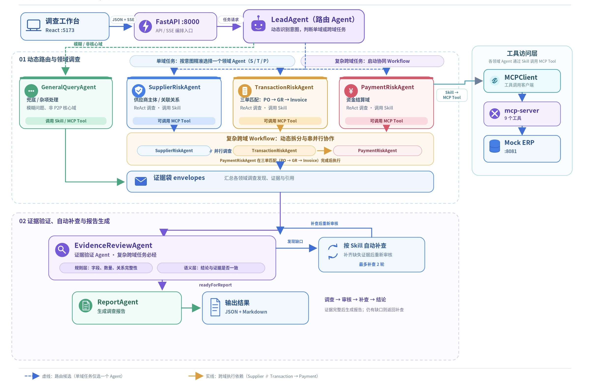
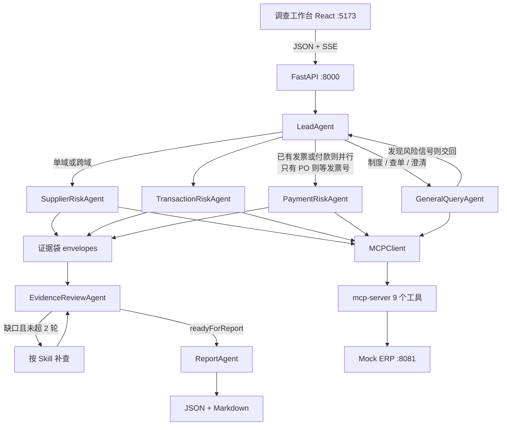

# Finprobe

面向企业采购到付款（P2P）全链路的**供应链智能风控 Multi-Agent 调查**系统。

用自然语言发起调查，系统会路由到对应领域 Agent，按业务 Skill 调用 MCP 工具查询 ERP，给出可追溯的风险结论、证据和正式报告。它把 **路由、调查执行标准、工具契约、证据闭环、评测集** 写成可执行协议。

## 为什么值得看

企业风控调查的真实难点在：

- 问题可能是查制度、查一张单，也可能是对一家供应商做采购到付款全量排查
- 结论必须能指回单据、审批和计算口径，不能靠模型「感觉有风险」
- 供应商可能有几十上百张发票，不能把全量明细塞进上下文
- 跨域任务需要多 Agent 协作，但需要明确职责边界

Finprobe 用一套明确的分层回答这些问题：

```
用户问题
  → LeadAgent 路由（不判风险）
    → 领域 Agent ReAct
      → Skill（查什么、如何分级、如何消解）
        → MCP Tool
          → Mock ERP HTTP API
```

阈值、风险类型和输出字段写在 Skill 里，而不是重写成一套 Python 规则引擎。以后把 `ERP_BASE_URL` 换成真实 ERP，调查链路不用重做。

## 你能看到什么

- **调查工作台**：对话发起调查；右侧实时展示 Agent 的思考 / 行动 / 观察
- **业务数据**：供应商、采购订单、入库单、发票、付款、审批、制度均可浏览，并一键发起调查
- **证据与报告**：独立页面查看查询账、审批消解状态、JSON + Markdown 报告
- **数据看板**：账套规模、金额分布，以及 27 家供应商的风险标注总览

覆盖 8 类风险：供应商主信息异常、供应商之间关联关系风险、少货多付/数量/金额异常、拆单避审、重复发票、税率异常、重复付款、异常收款账户。等级只有四档：高风险、中风险、低风险、证据不足。

## 架构





七个 Agent 职责隔离：

| Agent | 做什么 | 不做什么 |
| --- | --- | --- |
| LeadAgent | 抽实体、定范围、选 Skill、合并证据袋 | 不下风险等级 |
| SupplierRiskAgent | 主信息、关联关系 | 不判三单、拆单、付款 |
| TransactionRiskAgent | 三单匹配、拆单、重复发票、税率 | 不判重复付款、收款账户 |
| PaymentRiskAgent | 重复付款、异常收款账户 | 不重做三单数量匹配 |
| GeneralQueryAgent | 制度问答、查单、澄清 | 不给出最终风险等级 |
| EvidenceReviewAgent | 审信封、提出补查任务 | 不查 ERP、不改原始 facts |
| ReportAgent | 把已审证据写成报告 | 不发明新的风险类型 |

Web 应用里的 MCP 调用走后端统一 `MCPClient`（当前内部 dispatch 现有工具）。领域 Agent 不直接 `curl` ERP，也不读取 `mock-erp/data/*.json`。

## 仓库结构

```
Finprobe/
  AGENTS.md                 执行合同：路由、协作、约束
  src/contracts/            冻结的 HTTP / SSE / 信封契约
  src/backend/              FastAPI + LeadAgent 编排器
  src/frontend/             Vite + React 调查工作台
  mock-erp/                 模拟 ERP（REST，不是 MCP）
  mcp-server/               MCP 适配器：HTTP 调 ERP
  skills/                   10 个业务 Skill
  evals/gold/               跨域 27 案 + 单域 10 案评测草稿
  tests/backend/            契约、路由、健康检查回归
  scripts/                  启动脚本
```

## 快速开始

需要 Python 3.12、Node.js 18+。Windows / macOS / Linux 均可。

### 1. 安装

```bash
python -m venv finprobe_env
# Windows: .\finprobe_env\Scripts\Activate.ps1
# macOS / Linux: source finprobe_env/bin/activate
python -m pip install -r requirements.txt

cd src/frontend
npm install
cd ../..
```

### 2. 配置环境变量

复制 `.env.example` 为 `.env`：

```env
ERP_BASE_URL=http://127.0.0.1:8081
ERP_API_KEY=qh_live_5fc45e4c22871d81ef7d47ea7b69aa2f
DEEPSEEK_API_KEY=your_key
DEEPSEEK_BASE_URL=https://api.deepseek.com
DEEPSEEK_MODEL=deepseek-flash
```

`ERP_API_KEY` 只用于本地 Mock ERP，不要写进 Skill 或报告。调查执行需要 LLM；兼容 OpenAI Chat Completions 的网关都可以，也识别 `OPENAI_API_KEY`。

### 3. 启动三个进程

终端 1 — Mock ERP：

```bash
python mock-erp/server.py
```

终端 2 — 后端：

```bash
python -m uvicorn src.backend.app.main:app --host 127.0.0.1 --port 8000
```

终端 3 — 前端：

```bash
cd src/frontend
npm run dev
```

打开 [http://127.0.0.1:5173](http://127.0.0.1:5173)。

| 服务 | 地址 | 说明 |
| --- | --- | --- |
| 工作台 | http://127.0.0.1:5173 | 对话、ERP 浏览、看板 |
| 后端 API | http://127.0.0.1:8000/v1/health | 契约见 `src/contracts/` |
| Mock ERP | http://127.0.0.1:8081/health | 业务接口需要 `X-Api-Key` |

直接用浏览器打开 `http://127.0.0.1:8081/` 会看到未授权，这是预期行为。请走工作台或后端 `/v1/erp/*`。

也可用 `scripts/start_erp.ps1`、`scripts/start_backend.ps1`、`scripts/start_frontend.ps1`。

## 试一个调查

在工作台提问，或从业务数据页点击「调查风险」：

```text
请全面排查供应商 VEN-0044 有无风险？
订单 PO-01332 从采购到付款全面排查，能否付款？
差旅住宿标准是多少？
```

预期行为：

- 制度问答走 `policy_qa`，不派付款 Agent，不出正式报告
- 缺实体时只问 **一个** 澄清问题
- 「全面排查供应商」走跨域：供应商域与交易域并行，付款域在拿到发票号后执行
- 大列表只给 summary / sample / artifact，聚合走 `financial-analysis`

## 核心设计

### 先定范围，再派 Agent

不是每个问题都跑齐 10 个 Skill。LeadAgent 先定 `scope` 和 `mode`：

| mode | 何时 | 后续 |
| --- | --- | --- |
| `clarify` | 非制度问题且缺少可绑定实体 | 只问一个澄清问题 |
| `policy_qa` | 纯制度 | GeneralQueryAgent |
| `lookup` | 查单 / 探查 | 发现风险信号必须交回 LeadAgent |
| `single` | 只命中一个领域 | 一个 RiskAgent |
| `cross` | 两个及以上领域，或用户明确「全面排查」 | 多 Agent 协作 + 证据审核 |

### 证据必须闭环

- 声称「无审批 / 已消解」时，必须真的调用过 `approval-query`
- 跨域或出正式报告前必须经过 EvidenceReviewAgent
- 补查最多 2 轮；仍有缺口则 `readyForReport=false`，不能假装终稿
- 已确认的高风险不会被另一条「证据不足」稀释

### 大结果不进模型

查询类工具统一返回：

- 小结果内联 `data`
- 大结果只给 `summary` + `sample` + `artifact`
- 统计用 `financial-analysis`，再看几条用 `artifact-get`

九个工具名保持稳定：`vendor-query`、`po-query`、`gr-query`、`invoice-query`、`payment-query`、`approval-query`、`policy-query`、`financial-analysis`、`artifact-get`。

## 评测

仓库提供两份标准评测集，用来衡量 **跨域 Multi-Agent 协作** 和 **单域调查**：

| 文件 | 规模 | 状态 |
| --- | --- | --- |
| `evals/gold/cross_supplier_v1.draft.json` | 27 家供应商，每家可有多个风险 | 确认 |
| `evals/gold/single_domain_v1.draft.json` | 10 个单域问题（单据 / 关联 / 制度） | 确认 |

标准答案包含风险领域、风险类型、风险等级和必要证据。它们是评测草稿，不是已经刷出来的准确率榜。路由与协作规则以 `AGENTS.md` 为准。

## 技术栈

- 后端：Python 3.12、FastAPI、Pydantic v2、SQLite 会话
- 前端：Vite、React、TypeScript
- 工具层：自研 MCP 适配器 + 统一 `MCPClient`（暂时）
- 模型：OpenAI 兼容 Chat Completions（默认 DeepSeek）
- 数据：本地 Mock ERP，标准库 `http.server`

## 测试

```bash
python -m pytest tests/backend -q
```

当前覆盖契约、路由、健康检查、MCP client、ReAct 循环和看板接口。跑调查相关测试前请先启动 Mock ERP。

## 现状与边界

已经落地：Mock ERP、9 个 MCP 工具、10 个 Skill、LeadAgent 编排、领域 Agent、证据审核、报告、工作台、看板、评测草稿。

这是本地演示系统，默认只绑定 `127.0.0.1`，没有登录。适合作为 Multi-Agent、MCP 和证据式调查的完整样本，而不是生产 ERP 插件。


## 深入阅读

- [`AGENTS.md`](./AGENTS.md) — Agent 执行合同，改路由或协作先读这个
- [`src/contracts/README.md`](./src/contracts/README.md) — HTTP / SSE / 信封契约
- [`skills/`](./skills/) — 每个风险类型的调查步骤和阈值

## License
