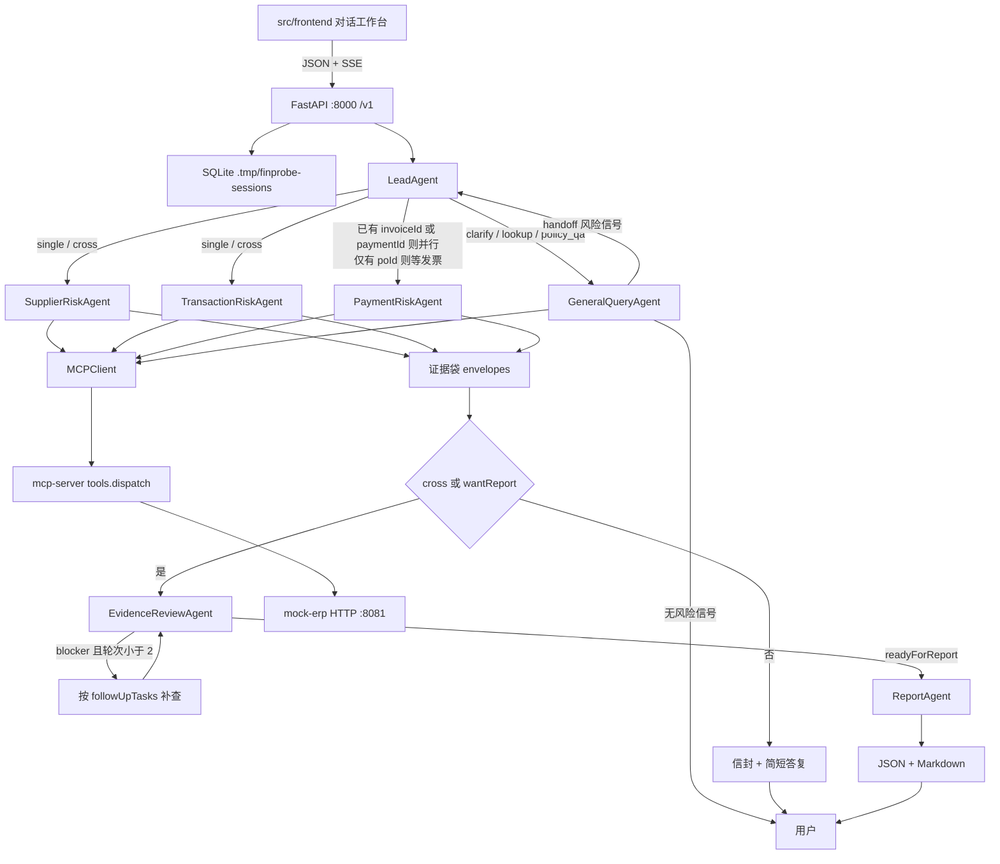

# Finprobe HTTP 契约（冻结）

本目录是前后端的接口合同。**冻结后只读**：改字段先改本目录和 `AGENTS.md`，再改实现。

调查链路不可改：

```
用户 → LeadAgent → 领域 Agent → SKILL.md → MCP Tool → mock-erp
```

禁止：Agent/Skill 直接读 `mock-erp/data/*.json`；Agent `curl` ERP；把阈值重写成 Python 规则引擎。

## 架构



## 七个 Agent

| Agent | 职责 | 禁止 |
| --- | --- | --- |
| LeadAgent | 抽实体、定 scope/mode、选 Skill、合并证据袋、最多 1 次定位查询 | 不下风险等级 |
| SupplierRiskAgent | 主信息、关联关系 | 不判三单/拆单/付款 |
| TransactionRiskAgent | 三单、拆单、重复发票、税率 | 不判重复付款/收款账户 |
| PaymentRiskAgent | 重复付款、异常收款账户 | 不重做三单数量匹配 |
| GeneralQueryAgent | 制度、查单、澄清；发现信号 handoff | 禁止最终风险等级 |
| EvidenceReviewAgent | 规则层 + 语义层审信封 | 不查 ERP、不改 facts |
| ReportAgent | 已审证据写成 JSON + Markdown | 不查 ERP、不发明风险类型 |

## 并行规则

- Supplier 与 Transaction 并行
- Payment：已有 `invoiceId` / `paymentId` 时与 Transaction 并行；只有 `poId` / 供应商时等 Transaction 回传发票号
- 证据袋写入串行
- 补查最多 2 轮

## 本目录文件

- `http-api.md` — 路径、状态机、SSE、断线恢复
- `errors.schema.json` — 错误包
- `investigation.schema.json` — 调查快照
- `events.schema.json` — SSE 事件
- `enums.json` — 枚举冻结

字段名与八类风险名称以 `AGENTS.md` 和各 `skills/*/SKILL.md` 为准。