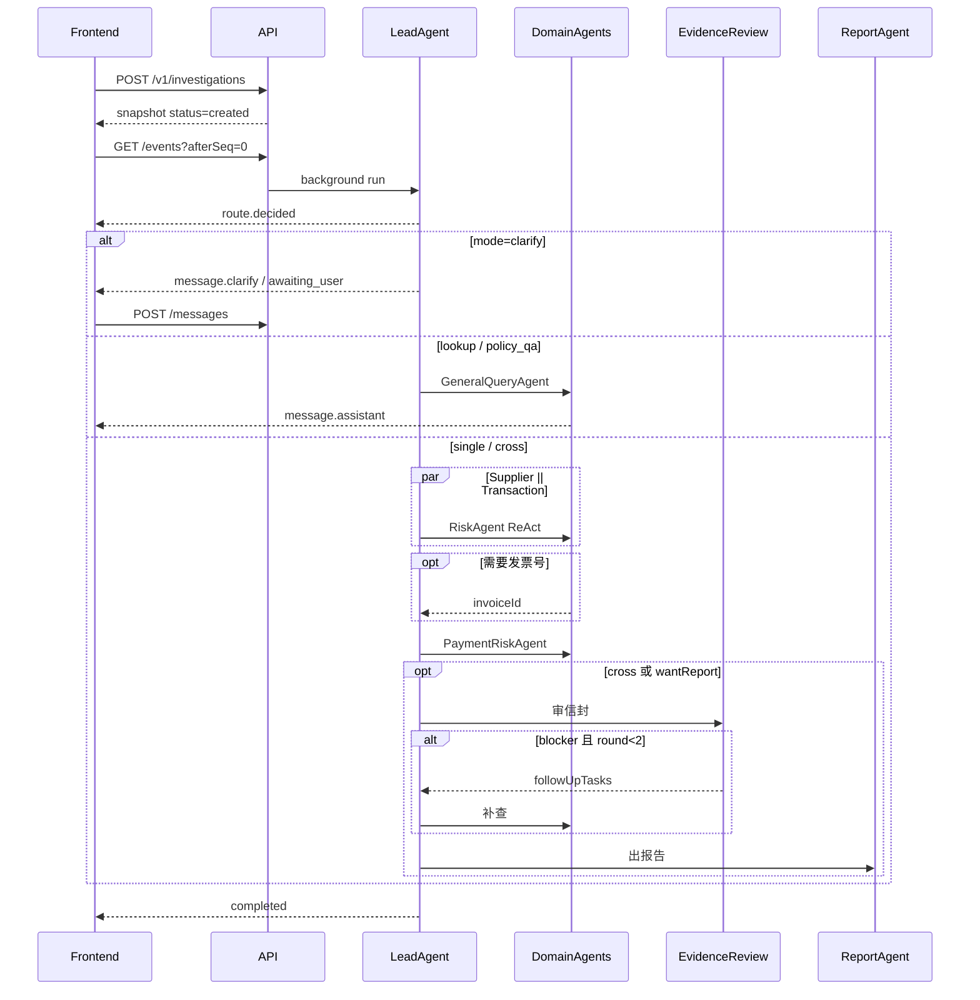

# HTTP API

Base: `http://127.0.0.1:8000`。JSON，UTF-8。v1 只绑定 `127.0.0.1`，无登录。ERP API Key 不得进入前端。

成功包：`{ "ok": true, ... }`。失败包见 `errors.schema.json`。

## 路径

| Method | Path | 作用 |
| --- | --- | --- |
| GET | `/v1/health` | 探测 erp / mcp / llm。ERP 未启动时整体 `ok=false`，`error.code=ERP_UNAVAILABLE`，HTTP 503 |
| POST | `/v1/investigations` | 创建调查。body: `{ "question": string, "wantReport": boolean? }` |
| GET | `/v1/investigations/{id}` | 全量快照，刷新和断线恢复的权威源 |
| GET | `/v1/investigations/{id}/events` | SSE。`?afterSeq=` 或 `Last-Event-ID` |
| POST | `/v1/investigations/{id}/messages` | 澄清回答 `{ "content": string }`。仅 `awaiting_user` |
| POST | `/v1/investigations/{id}/cancel` | 协作式取消 |
| GET | `/v1/investigations/{id}/report` | `{ report, markdown, draft }` |

## wantReport

请求可省略。省略时由 Lead 推断：`single` / `cross` 为 true；`policy_qa` / `lookup` / `clarify` 为 false。显式传入则覆盖。

## 调查状态

```
created → routing → locating → running → awaiting_user
                                  ↓
                             reviewing → follow_up → running
                                  ↓
                             reporting → completed | failed | cancelled
```

- `policy_qa` / `lookup` / `clarify` 不进入 `reviewing`
- `cross` 或 `wantReport=true` 必须进入 `reviewing`
- `follow_up` 最多 2 轮（最多 3 次审核）
- 终态：`completed` / `failed` / `cancelled`

## SSE

`Content-Type: text/event-stream`。`id` 为调查内单调递增整数（与快照 `eventSeq` 一致）。每 15s 发送 `heartbeat`（不落库、不占 seq）。

```
id: 12
event: tool.completed
data: {"seq":12,"type":"tool.completed","ts":"2026-10-22T12:00:00+08:00","payload":{"tool":"invoice-query","ok":true,"totalCount":36,"artifactId":"art-..."}}
```

事件类型：`status.changed` `route.decided` `agent.started` `agent.completed` `tool.started` `tool.completed` `envelope.upserted` `evidence.completed` `report.completed` `message.assistant` `message.clarify` `heartbeat` `error`。

工具事件只带 `tool / ok / totalCount / artifactId / error`，禁止把发票全量数组推到前端。

## 断线恢复

1. `GET /v1/investigations/{id}` 拿到快照
2. `GET /v1/investigations/{id}/events?afterSeq={eventSeq}`
3. 服务端重放该 seq 之后的持久化事件（每调查最多保留 500 条）
4. 浏览器 `Last-Event-ID` 与 `afterSeq` 等价；取较大值

## 协作时序



## 运行环境

- 后端绑定 127.0.0.1:8000；Mock ERP 127.0.0.1:8081
- LLM：优先 DEEPSEEK_API_KEY / DEEPSEEK_BASE_URL / DEEPSEEK_MODEL（默认 https://api.deepseek.com + deepseek-flash）；也可使用 FINPROBE_LLM_* 或 OPENAI_API_KEY
- Mock ERP Key 固定 ERP_API_KEY=qh_live_5fc45e4c22871d81ef7d47ea7b69aa2f（仅本地 mock，不进前端）
- 会话库：.tmp/finprobe-sessions/finprobe.db
- 前端开发服务器 127.0.0.1:5173，通过 Vite proxy 访问 /v1；也可设 VITE_API_BASE=http://127.0.0.1:8000
- 未配置 LLM 时：GET /v1/health 仍可在 ERP+MCP 就绪时 ok=true，但调查执行返回 LLM_ERROR
